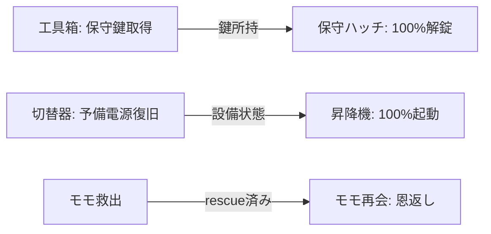

# イベント連携依存関係

この表はPhase 1で実装した検証用プロトタイプの関係を示す。各プロトタイプは200件完成数に含めず、Phase 2で最終イベントIDに置換または再設計する。

| 起点 | 成立する選択結果 | 状態変化 | 後続の区画/イベント | 条件成立時 | 不成立時 |
|---|---|---|---|---|---|
| `prototype-key-cache` | 仕分け/箱を振るの成功 | `service-key` を取得 | 区画2 `prototype-key-hatch` | 保証出現し、保守鍵アクション100%。使用/消費履歴を記録 | ハッチは候補から除外。通常候補で進行 |
| `prototype-aux-switch` | 端子をつなぎ直す成功 | `aux-power = true` | 区画4 `prototype-powered-lift` | 保証出現。起動成功率100% | 電源復旧に失敗したら昇降機イベントを除外。通常候補で進行 |
| `prototype-momo-rescue` | 棚から救出/固定成功 | `momo = rescued` | 区画5 `prototype-momo-thanks` | 保証出現し、同じ名前・外見・性格・話し方のNPCが再登場。恩返し後 `repaid` | `rescue-failed`/`encountered`では恩返しを候補に含めず、区画5通常候補へ |
| `prototype-aux-switch` | ヒューズ回収成功 | `copper-fuse` を取得 | Phase 2で消費イベントを追加予定 | 未接続。今回の3必須連携には数えない | 通常経路を維持 |

## 到達可能性ルール

- `availableWhen` はイベント抽選直前の確定状態で評価する。
- 保証イベントは保証条件成立後、対象区画の次の空きタイルで最優先する。通常抽選に先取りされない。
- 後続条件が外れた場合はイベントを候補から除外し、会話や結果文も成立を仮定しない。
- 連携のない通常候補は各区画40件確保し、連携条件が一つも成立しなくても20マスを重複なく進められる構成にする。
- 条件ループや相互排他はPhase 2のシナリオ検証で表にし、保証件数だけでは検出できない状態変化も検査する。
- テスト用の100件fixture catalogはエンジンの反復・seedテスト専用で、イベント制作台帳や完成数に含めない。
